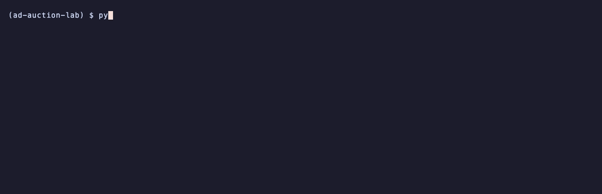
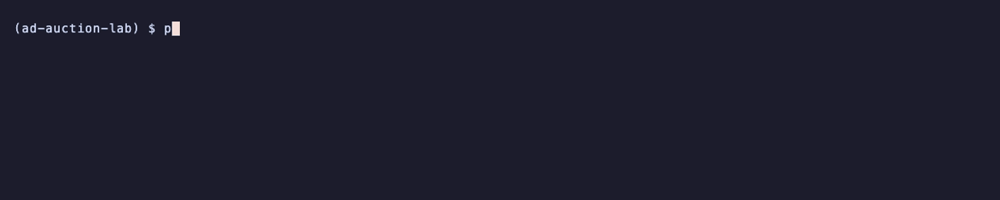
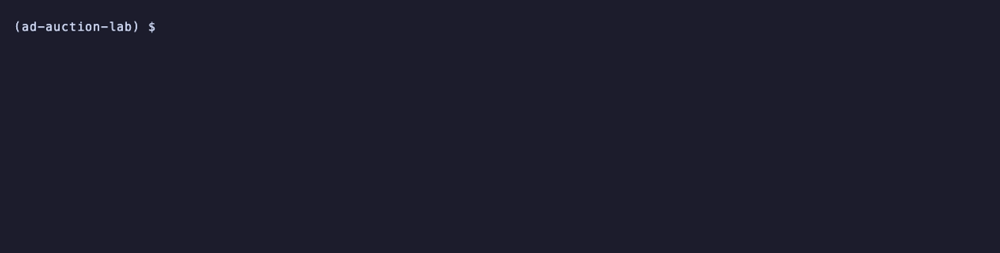
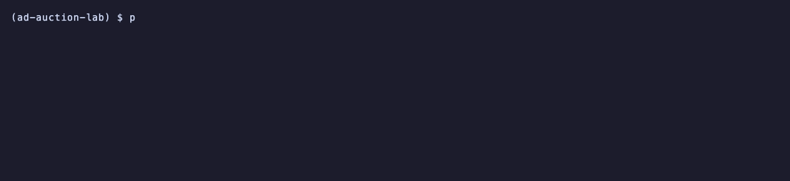

<h1 align="center">Ad Auction Lab</h1>

<p align="center">
  <em>Position auctions, bid shading, budget pacing, hashed CTR models and off-policy evaluation, measured on Criteo and the Open Bandit Dataset.</em>
</p>

<p align="center">
  <a href="https://github.com/adeoluo/ad-auction-lab/actions/workflows/ci.yml"></a>
  <a href="https://github.com/adeoluo/ad-auction-lab/releases"></a>
  
  
  <a href="LICENSE"></a>
</p>

---

## Motivation

An ad system makes three linked decisions for every impression: how likely a click is, who wins
the auction and at what price, and how much each advertiser should bid given a budget. Each one
is easy to get subtly wrong. A miscalibrated click model misprices every slot, a pricing rule that
is not truthful invites bid manipulation, and a pacing controller that overreacts spends a daily
budget by noon. Policies are also changed offline, from logs collected by a different policy, so
the estimate of a new policy's value is itself a model that needs checking.

This repository implements each piece with the math written out in the docstrings, measures it on
public data (11.46M Criteo click rows, the full Open Bandit Dataset with 13.7M logged rounds,
16.5M Criteo market prices), and checks it against reference libraries (obp, scikit-learn, PyTorch) and published
numbers. The hot loops (FTRL, the factorization machine, the pacing simulator) run in a Rust core
with a numpy reference kept for parity tests.

## Architecture

<p align="center">
  
</p>

<sub>Legend: amber = entry points and external systems, indigo = core logic, green = data and state, blue = validation and control, grey = observability and outputs.</sub>

The CLI and the HTTP service validate their inputs and load memory-mapped data prepared by
`make data`: Criteo click rows, Open Bandit logs and Criteo market prices. The CTR models (FTRL
logistic regression and a factorization machine on hashed features, in Rust) produce the quality
scores that the auctions (GSP, VCG, first price, with reserves and a squashing exponent) rank by,
and the bidding layer shades first-price bids and paces budgets against real market prices. The
off-policy estimators reuse the CTR models as reward models. Every result passes through the same
metrics (logloss, AUC, normalized entropy, calibration, bootstrap intervals) into JSON under
`benchmarks/results/`, and the service counts requests in `/metrics`. Module details are in
[docs/ARCHITECTURE.md](docs/ARCHITECTURE.md); key decisions are in the [ADRs](docs/adr/).

## Results

All numbers come from `make evaluation` on an Apple M1 (8 cores, 8 GB, shared with other work),
raw JSON in [benchmarks/results/](benchmarks/results/); `make report` prints these tables. The
full walkthrough, with threats to validity, is in
[docs/EVALUATION_REPORT.md](docs/EVALUATION_REPORT.md).

### Headline

| Component | Measured on | This repo | Compared with | Outcome |
|---|---|---:|---:|---|
| CTR, factorization machine | Criteo, 1.15M test rows, 3 splits | logloss 0.4518, AUC 0.7991 | PyTorch FM, same features (2^20): 0.4532 / 0.7975 | win (ours at 2^20: 0.4523 / 0.7985) |
| CTR, FTRL logistic regression | same, 1 pass | logloss 0.4602, AUC 0.7893 | scikit-learn SGD: 0.4675 / 0.7805 | win |
| CTR against published | Criteo | FM 0.4518 / 0.7991 on 9.17M rows | BARS FM 0.4431 / 0.8086 on 36.7M rows (quoted) | loss |
| Off-policy estimators | Open Bandit, 6 settings | max abs difference 6.1e-18 | obp 0.5.7 | tie (identical) |
| Off-policy accuracy | Open Bandit, 13.7M rounds | best estimator within 0.2% to 9.5% of on-policy truth | | no single best estimator |
| Auction incentives | 20,000 auctions x 24 configurations | VCG: 0.0% profitable deviations | GSP up to 21.6%, first price up to 59.2% | as theory predicts |
| Bid shading | Criteo prices, 10 later days | 99.8% to 100% of oracle surplus | log-normal landscape 97.9% to 99.6% | win |
| Budget pacing | 1M auctions, 5 seeds | dual descent 0.996 to 0.999 of hindsight optimum | PID 0.32 to 0.98 | win |
| Rust core | same inputs, identical outputs | FTRL 128x, FM 96x, pacing 58x to 162x | Python reference | win |

### CTR models on Criteo

Data: every 4th row of the Criteo Display Advertising Challenge `train.txt` (11,460,155 of
45,840,617 rows, base rate 25.6%), split at random 80/10/10 (9,168,124 train, 1,146,015
validation, 1,146,016 test rows). Hyperparameters were chosen on validation
([ctr_sweep.json](benchmarks/results/ctr_sweep.json), [ctr_sweep_fm.json](benchmarks/results/ctr_sweep_fm.json));
the test split is used only below. Mean ± standard deviation over 3 random splits; 2^22 hash
buckets; FTRL trains 2 passes, the FM 1 pass (every FM overfits on its second pass).

| Model | Test logloss | Test AUC | Normalized entropy | Calibration (pred / actual) | ECE |
|---|---:|---:|---:|---:|---:|
| LR, FTRL-Proximal (alpha 0.05, L1 1) | 0.4586 ± 0.0003 | 0.7911 ± 0.0001 | 0.8059 ± 0.0005 | 1.004 ± 0.002 | 0.0028 ± 0.0003 |
| Factorization machine (k 32, AdaGrad 0.01) | 0.4518 ± 0.0002 | **0.7991 ± 0.0001** | 0.7939 ± 0.0004 | 0.998 ± 0.002 | 0.0062 ± 0.0002 |
| FM + isotonic calibration (fit on validation) | **0.4516 ± 0.0002** | **0.7991 ± 0.0001** | **0.7935 ± 0.0004** | 1.001 ± 0.000 | **0.0012 ± 0.0002** |

On the seed 0 test split the FM beats FTRL by +0.0083 AUC (DeLong 95% CI [+0.0080, +0.0085])
and -0.0070 logloss (paired CI [-0.0073, -0.0068]). Isotonic calibration cuts the FM's expected
calibration error by 5x; Platt scaling leaves it unchanged (0.0061).

Reference libraries on the same hashed features and the same seed 0 splits, each tuned on
validation with its own small grid ([ctr_reference_sklearn.json](benchmarks/results/ctr_reference_sklearn.json),
[ctr_reference_torch.json](benchmarks/results/ctr_reference_torch.json)):

| Model | Buckets | Passes | Test logloss | Test AUC | Train s | Result |
|---|---:|---:|---:|---:|---:|---|
| This repo: FTRL-Proximal | 2^22 | 1 | **0.46016** | **0.78926** | **11.5** | win |
| scikit-learn `SGDClassifier` (log loss, best of 7 step sizes) | 2^22 | 1 | 0.46753 | 0.78053 | 53 | loss |
| This repo: factorization machine (k 32) | 2^20 | 1 | **0.45226** | **0.79853** | **81** | win |
| PyTorch FM (k 32, sparse Adagrad, batch 1024, best of 3 rates x 2 passes) | 2^20 | 1 | 0.45324 | 0.79748 | 275 | loss |
| Constant base rate | | | 0.56904 | 0.50000 | | |

The PyTorch FM runs at 2^20 buckets because at 2^22 its factors and Adagrad state (1 GB) made
the shared 8 GB machine swap; it is compared with this repo's FM at the same size. Its best rate
was the smallest in its grid (0.02), so a smaller rate might narrow the 0.001 gap. scikit-learn's
time includes building sparse matrices from the hashed rows.

Against published numbers (quoted from the [BARS benchmark](https://openbenchmark.github.io/BARS/CTR/leaderboard/criteo_x4.html),
Zhu et al. 2021, not rerun here). BARS trains on the full 36.7M-row split with a vocabulary
(minimum count 10) and embedding size 16, so the gap mixes the 4x smaller training set with the
model difference:

| Model | Train rows | Test logloss | Test AUC |
|---|---:|---:|---:|
| This repo: LR, FTRL-Proximal | 9.17M | 0.4586 | 0.7911 |
| This repo: factorization machine | 9.17M | 0.4518 | 0.7991 |
| BARS: LR | 36.7M | 0.4568 | 0.7934 |
| BARS: FM | 36.7M | 0.4431 | 0.8086 |
| BARS: FFM | 36.7M | 0.4407 | 0.8113 |
| BARS: DeepFM | 36.7M | 0.4376 | 0.8143 |

Ablations on the seed 0 test split ([ctr_ablation.json](benchmarks/results/ctr_ablation.json)):

| Ablation | FTRL logloss | FTRL AUC | FM logloss | FM AUC |
|---|---:|---:|---:|---:|
| Full model (2^22 buckets, 39 fields, 9.17M rows) | 0.45869 | 0.79097 | 0.45165 | 0.79922 |
| 2^16 buckets | 0.46441 | 0.78389 | 0.45521 | 0.79491 |
| 2^20 buckets | 0.45917 | 0.79036 | 0.45226 | 0.79853 |
| 2^24 buckets | 0.45855 | 0.79113 | not run | not run |
| 13 integer fields only | 0.51190 | 0.71463 | 0.50809 | 0.72001 |
| 26 categorical fields only | 0.48077 | 0.76229 | 0.47561 | 0.76978 |
| 100k training rows | 0.48622 | 0.75509 | 0.48838 | 0.75350 |
| 1M training rows | 0.46951 | 0.77767 | 0.46814 | 0.77971 |
| 3M training rows | 0.46330 | 0.78545 | 0.45911 | 0.79065 |

The FM at 2^24 buckets needs 4 GB of factors and AdaGrad state at k = 32 and was not run. FM rank
k = 1, 4, 16, 32 gives test logloss 0.46003, 0.45735, 0.45315, 0.45165. FTRL's L1 = 1 halves the
nonzero weights (3,722,562 to 1,775,280) for +0.00014 logloss; L1 = 16 keeps 48,888 weights at
0.46114. FTRL beats the FM at 100k rows (and on logloss at 300k); the FM still gains about 0.005 AUC per doubling of the
training set between 3M and 9.17M rows, which suggests (untested) that most of the 0.0095 AUC gap
to the BARS FM is the 4x smaller sample.

Rust core against the Python reference, both on the same 200,000 training rows and 20,000
prediction rows at 2^20 buckets, back to back in one process
([ctr_speed.json](benchmarks/results/ctr_speed.json)); predictions are identical:

| Model | Rust train rows/s | Python train rows/s | Speedup | Rust predict rows/s | Python predict rows/s |
|---|---:|---:|---:|---:|---:|
| FTRL-Proximal | 794,078 | 6,227 | 128x | 1,003,632 | 29,667 |
| Factorization machine (k 32) | 57,810 | 604 | 96x | 633,231 | 1,798 |

On the full 9.17M-row training split FTRL trained 0.7M to 2.9M rows per second and the FM 37k to
290k across the runs, depending on machine load.

### Off-policy evaluation on the Open Bandit Dataset

The full Open Bandit Dataset (ZOZOTOWN fashion recommendations, 13.73M rounds in the all campaign,
of which men and women are subsets), logged once by a uniform random policy and once by Bernoulli
Thompson sampling (BTS). Each setting estimates one policy's click rate
from the other policy's log and compares it with the click rate that policy actually achieved
(the on-policy truth, as in Saito et al. 2021). Relative error |estimate - truth| / truth; DM and
the DR family use the smoothed item-position click model; 95% intervals from 200 Poisson bootstrap
replicates ([ope_obd.json](benchmarks/results/ope_obd.json)).

| Setting (log rounds) | Truth | IPS | SNIPS | DM | DR | SNDR | Switch-DR |
|---|---:|---:|---:|---:|---:|---:|---:|
| all: BTS from random (1.37M) | 0.00495 | **0.003** | 0.005 | 0.006 | 0.006 | 0.006 | 0.006 |
| all: random from BTS (12.36M) | 0.00347 | 0.010 | 0.050 | **0.002** | 0.039 | 0.037 | 0.012 |
| men: BTS from random (0.45M) | 0.00674 | 0.109 | 0.099 | 0.096 | **0.095** | **0.095** | **0.095** |
| men: random from BTS (4.08M) | 0.00512 | 0.025 | 0.070 | **0.020** | 0.041 | 0.036 | 0.047 |
| women: BTS from random (0.86M) | 0.00638 | 0.032 | 0.031 | 0.030 | **0.029** | **0.029** | **0.029** |
| women: random from BTS (7.77M) | 0.00482 | 0.044 | 0.080 | 0.005 | 0.064 | 0.061 | **0.004** |

No estimator wins everywhere. Evaluating the uniform policy from the BTS log is the hard
direction (importance weights up to 29,412, effective sample size 1,513 of 4.08M rounds on men):
there DM and Switch-DR, which avoid the largest weights, do best, while SNIPS is worst in all
three campaigns. In the easy direction (weights at most 10) every estimator is within 0.7% on the
all campaign. On the men campaign every estimator misses by about 10% and no interval covers the
truth; the error is shared by IPS, which uses no model, so it comes from the evaluation setup
(the target policy is represented by BTS's average item distribution, but BTS changed over the
week) rather than from an estimator.

On the random logs, which have user context, cross-fitted contextual reward models (hashed FTRL
and FM with user, item and user-by-item features) made DM worse than the item-position model
(relative error 0.094 and 0.064 against 0.006 on all) and left DR unchanged, because the click
signal is weak (0.35% CTR). Switch-DR's threshold matters only in the hard direction: on all, switching
to the model above the 99th percentile of the weights gives 0.012, above the 90th under 0.001, and no
switching (plain DR) 0.039 ([ope_ablation.json](benchmarks/results/ope_ablation.json)); the
default (99th percentile) was fixed before these runs. Over 30 random subsamples per size, the
error for BTS from random falls from 0.18 to 0.20 at 10k rounds to 0.047 to 0.048 at 300k for every
estimator; in the hard direction at 10k rounds DR is off by 0.53 on average, DM and Switch-DR by
0.20 and 0.19 ([ope_curve.json](benchmarks/results/ope_curve.json)).

Agreement with [obp](https://github.com/st-tech/zr-obp) 0.5.7 on 200k-round samples of all six
settings ([ope_obp.json](benchmarks/results/ope_obp.json)):

| Estimator | Max abs difference from obp | Point estimate speedup | Bootstrap time vs obp |
|---|---:|---:|---:|
| IPS | 0.0e+00 | 89x | 0.6x (slower) |
| SNIPS | 1.7e-18 | 63x | 0.5x (slower) |
| DM | 5.2e-18 | 56x | 0.9x (slower) |
| DR | 5.2e-18 | 97x | 1.3x |
| SNDR | 5.2e-18 | 90x | 0.6x (slower) |
| Switch-DR | 6.1e-18 | 69x | 0.9x (slower) |

Point estimates agree to floating point rounding. For intervals obp resamples indices and this
implementation draws Poisson weights; timed per estimator (100 replicates, 200k rounds) it is
slower in 5 of 6 cases. In the benchmark it draws the weights once for all estimators of a log
(`bootstrap_many`), which this per-estimator timing does not credit.

### Auctions, reserves and incentives

Values and quality scores come from real data: a per-click value is a resampled Criteo
Attribution market price divided by a resampled FM-predicted CTR from the Criteo test split, and
quality scores are resampled FM CTRs. Each configuration runs 20,000 auctions; every bidder in
turn scales its bid by 13 factors from 0 to 4 while the others bid truthfully
([auction_incentives.json](benchmarks/results/auction_incentives.json)).

| Mechanism | Bidder-auctions with a profitable deviation (no reserve) | With the empirical reserve |
|---|---:|---:|
| VCG (affine maximizer) | **0.0%** in all 12 configurations | **0.0%** |
| GSP | 0.0% with 1 slot, 7.0% to 21.6% with 3 to 5 slots | 0.0% to 0.6% |
| First price | 9.6% to 59.2% | 4.9% to 7.2% |

GSP at the lowest envy-free equilibrium of Edelman, Ostrovsky and Schwarz reproduces VCG's
allocation in 100% of 4,000 auctions and its revenue to a relative difference of 4.3e-16, while
truthful GSP bidding would collect 1.8x (5 bidders, 3 slots) and 2.0x (10 bidders, 5 slots) the
VCG revenue. The closed-form VCG prices match exhaustive search with Clarke payments on 1,800
auctions (max difference 4.7e-13).

Second-price reserves fit on 200,000 values and tested on 1,000,000 auctions
([auction_reserves.json](benchmarks/results/auction_reserves.json)):

| Bidders | No reserve: revenue | Myerson reserve (log-normal fit) | Empirical reserve | Welfare kept (empirical) |
|---:|---:|---:|---:|---:|
| 1 | 0.000 | 1.215 ± 0.007 | **1.244 ± 0.009** | 67% |
| 2 | 1.135 ± 0.006 | 2.417 ± 0.010 | **2.471 ± 0.013** | 70% |
| 5 | 4.848 ± 0.016 | 5.929 ± 0.018 | **6.012 ± 0.022** | 79% |
| 10 | 10.795 ± 0.027 | 11.435 ± 0.028 | **11.526 ± 0.030** | 91% |

The empirical revenue-maximizing reserve beats the Myerson reserve of a log-normal fit at every
market size because the value distribution is heavier tailed than log-normal; the revenue gain
from any reserve shrinks from 2.2x with 2 bidders to 7% with 10, at a falling welfare cost.

### First-price bid shading

The surplus-maximizing first-price bid against an estimated win-rate curve, fit on the first 21
days of the Criteo Attribution prices (11,405,791 impressions) and scored on the last 10 days
(5,062,236), against the oracle that is fit on the test days themselves
([bid_shading.json](benchmarks/results/bid_shading.json)):

| Value / median price | Truthful bid: surplus | Log-normal landscape | Empirical landscape (exact, convex hull) |
|---:|---:|---:|---:|
| 0.5 | 0% of oracle | 97.9% | **99.8%** |
| 1 | 0% | 98.3% | **100.0%** |
| 2 | 0% | 99.2% | **100.0%** |
| 5 | 0% | 99.6% | **100.0%** |
| 20 | 0% | 99.6% | **100.0%** |

Bidding the value in a first-price auction wins most often and earns nothing. The empirical
landscape keeps 99.8% to 100% of the oracle's surplus a week and a half later; per campaign (20
largest campaigns, value 2x the campaign median) a campaign's own landscape keeps 0.997 ± 0.003
and the pooled landscape 0.980 ± 0.018 (worst 0.945). Shading 1M values against the 11.4M training
prices takes 1.3 s after a 3.9 s fit.

### Budget pacing

Advertisers bid in repeated second-price auctions against an external market taken as a
contiguous, time-ordered window of the Criteo Attribution prices (so daily patterns stay), with
per-auction CTRs drawn from the FM's test predictions; each budget is a share of what that
advertiser would spend unpaced. 1,000,000 auctions, mean ± std over 5 seeds ([pacing.json](benchmarks/results/pacing.json)):

| Advertisers | Budget | Value won vs no pacing: PID | Dual descent | Budget exhausted at (none / PID / dual) |
|---:|---:|---:|---:|---:|
| 5 | 10% | 3.22 ± 0.14 | **5.23 ± 0.15** | 0.10 / 0.94 / 1.00 |
| 10 | 10% | 3.40 ± 0.16 | **5.49 ± 0.16** | 0.10 / 0.94 / 1.00 |
| 20 | 10% | 3.53 ± 0.08 | **5.67 ± 0.13** | 0.10 / 0.94 / 1.00 |
| 10 | 30% | 2.33 ± 0.04 | **2.55 ± 0.04** | 0.30 / 0.95 / 1.00 |
| 10 | 60% | 1.48 ± 0.01 | **1.51 ± 0.01** | 0.60 / 0.98 / 1.00 |

A single advertiser against the fractional knapsack optimum in hindsight: dual descent reaches
0.996 to 0.999 of the optimum at budgets from 5% to 60%, PID 0.32 to 0.98 and no pacing 0.18 to
0.71. PID with these gains reacts too slowly at small budgets. The Rust simulator runs 2.9M to
122M auctions per second, 58x to 162x the Python reference with identical results
([pacing_speed.json](benchmarks/results/pacing_speed.json)).

## Quickstart

```bash
git clone https://github.com/adeoluo/ad-auction-lab.git && cd ad-auction-lab
make setup           # uv sync (compiles the Rust core; needs a Rust toolchain) + pre-commit
make all             # lint, type check, tests

python -m ad_auction_lab auction --bids 4,2,1 --quality 0.05,0.08,0.06 --slots 0.3,0.2 --reserve 0.5
python -m ad_auction_lab incentives --auctions 5000 --bidders 5
```

The data commands need the prepared datasets (about 2.1 GB, streamed so the archives are never
stored):

```bash
make data            # Criteo 1 in 4, Open Bandit Dataset, Criteo Attribution into ../.bench-data/ad-auction-lab
make validation      # scikit-learn, PyTorch and obp for the reference comparisons
make evaluation      # every benchmark (several hours on an M1); make report prints the tables
```

## Usage

### Command line

| Command | What it does |
|---|---|
| `auction` | one position auction under GSP, VCG and first price, with reserve and quality squashing |
| `incentives` | share of bidders with a profitable deviation from truthful bidding, per mechanism |
| `shade` | first-price bid shading against the empirical landscape of Criteo market prices |
| `pace` | budget pacing (none, PID, dual descent) in a multi-advertiser market built from real data |
| `train-ctr` | train FTRL or the factorization machine on Criteo, report test metrics, save the model |
| `ope` | IPS, SNIPS, DM, DR, SNDR and Switch-DR on an Open Bandit campaign, with bootstrap intervals |
| `serve` | the HTTP service |

```bash
D=../.bench-data/ad-auction-lab
python -m ad_auction_lab train-ctr --data $D --model fm --k 32 --lr 0.01 --out fm.npz
python -m ad_auction_lab ope --data $D --campaign all --target bts --boot 200
python -m ad_auction_lab pace --data $D --horizon 2000000 --advertisers 10 --budget-share 0.3
```

### Library

```python
import numpy as np

from ad_auction_lab.auctions import run_auctions
from ad_auction_lab.ctr import FactorizationMachine
from ad_auction_lab.data import split_rows, synthetic_clicks
from ad_auction_lab.metrics import summary
from ad_auction_lab.ope import BanditLog, estimate, uniform_action_dist

# Three GSP auctions at once: bids and quality scores are (T, n), slot CTRs are (K,).
r = run_auctions(
    [[4, 2, 1], [1, 3, 2], [2, 2, 5]],
    [[0.05, 0.08, 0.06]] * 3,
    [0.3, 0.2],
    mechanism="gsp",
    reserve=0.5,
)
print(r.winner, r.price, r.revenue())

# A hashed factorization machine on synthetic clicks in the Criteo layout.
t = synthetic_clicks(200_000, seed=0)
train, valid, test = split_rows(len(t), seed=0)
fm = FactorizationMachine(k=8, lr=0.02, bits=18)
fm.fit(t, train, epochs=3, valid_rows=valid, patience=1)
print(summary(t.labels[test], fm.predict_proba(t, test), float(t.labels[train].mean())))

# IPS and SNIPS value of the uniform policy from a log of 3 actions in 1 position.
rng = np.random.default_rng(0)
a = rng.integers(0, 3, 10_000)
log = BanditLog.from_arrays(
    (rng.random(10_000) < 0.1 * (a + 1)).astype(float),
    a,
    np.full(10_000, 1 / 3),
    np.zeros(10_000, int),
    3,
    1,
)
print(estimate("ips", log, uniform_action_dist(3, 1)))
```

### HTTP service

A standard-library threaded service with request validation and size limits:

```bash
python -m ad_auction_lab serve --port 8000 --model fm.npz

curl localhost:8000/health
curl -s -X POST localhost:8000/auction \
  -d '{"bids": [4, 2, 1], "quality": [0.05, 0.08, 0.06], "slot_ctr": [0.3, 0.2], "mechanism": "vcg", "reserve": 0.5}'
curl localhost:8000/metrics
```

`POST /shade` returns shaded first-price bids for given values against a sample of market
prices, `POST /predict` scores hashed feature rows with the loaded CTR model, and `POST /ope`
runs the estimators on a posted log. `GET /ready` reports readiness and `GET /metrics` exposes
per-route request, error and latency counters in Prometheus text format.

### Demos

Recorded from real runs with [vhs](https://github.com/charmbracelet/vhs); each tape is in `docs/demo/`.

One auction under the three mechanisms, then the incentive check: only VCG leaves no bidder a
profitable deviation.

<p align="center">
  
</p>

The factorization machine trained on 1M Criteo rows, with test logloss, AUC, normalized entropy
and calibration.

<p align="center">
  
</p>

Off-policy estimates of the Bernoulli Thompson sampling policy from the 1.37M-round uniform
random log, against the click rate the policy achieved in its own 12.36M rounds.

<p align="center">
  
</p>

Ten advertisers pacing their budgets over 2M auctions priced by the Criteo market data.

<p align="center">
  
</p>

## Design decisions

- **Hashed CTR models in a Rust core.** Online learning is a sequential loop over rows that numpy
  cannot vectorize; the Rust FTRL and FM train 128x and 96x faster than the Python reference and
  give identical predictions. ([ADR-0002](docs/adr/0002-hashed-ctr-models-in-a-rust-core.md))
- **FTRL-Proximal and an AdaGrad factorization machine, trained in log order.** Per-coordinate
  learning rates and L1 sparsity are what production CTR systems use, and training in time order
  matches how they see data. ([ADR-0003](docs/adr/0003-ftrl-proximal-and-adagrad-fm-in-log-order.md))
- **Off-policy estimators as per-round terms.** Every estimator reduces to a mean of per-round
  terms plus a ratio, which gives one bootstrap for all of them and exact agreement with obp.
  ([ADR-0004](docs/adr/0004-ope-as-round-terms-matching-obp.md))
- **Closed-form position auctions with numeric incentive checks.** VCG with quality weights and
  reserves is an affine maximizer, checked against brute force; truthfulness is tested by
  searching bid deviations on real values. ([ADR-0005](docs/adr/0005-vcg-as-an-affine-maximizer-with-numeric-incentive-checks.md))
- **Pacing on real prices and CTRs.** The external market comes from Criteo's paid prices and the
  CTRs from the trained FM, so the controllers face real heavy tails and drift.
  ([ADR-0006](docs/adr/0006-pacing-simulator-on-real-prices-and-ctrs.md))
- **Datasets within a disk budget.** Criteo is streamed and subsampled 1 in 4 in time order;
  nothing is stored compressed. ([ADR-0007](docs/adr/0007-datasets-within-the-disk-budget.md))

## Testing

```bash
make lint        # ruff format --check and ruff check
make type        # mypy src (strict)
make coverage    # pytest with an 80% gate (192 tests, 98% branch coverage locally)
make rust-check  # cargo fmt, clippy and the Rust unit tests
make parity      # Rust core against the numpy reference, extension required
make validation  # against obp 0.5.7 and scikit-learn
```

- `test_auctions.py`: textbook GSP and VCG examples, quality scores, squashing, reserves, ties,
  VCG closed form against exhaustive search with Clarke payments, VCG truthful and GSP and first
  price not (hypothesis-generated auctions), GSP at the envy-free equilibrium matching VCG revenue,
  Myerson reserves (5/12 revenue for uniform values) and empirical reserves.
- `test_bidding.py`, `test_pacing.py`: shading against brute force on the landscape, the symmetric
  first-price equilibrium, log-normal landscape fits, budgets never exceeded, dual descent
  approaching the hindsight optimum, and the hindsight bound against greedy subsets.
- `test_ctr.py`, `test_hashing.py`, `test_metrics.py`, `test_data.py`: FTRL and FM learning, L1
  sparsity, early stopping, save and load (with a loader that refuses code), hashing stability,
  AUC against brute force with ties, DeLong variance against the bootstrap, Platt and isotonic
  calibration, Criteo parsing and integer binning.
- `test_ope.py`, `test_obd.py`: hand-computed estimates, recovery of a known policy value, DR
  unbiased with a wrong model, bootstrap intervals against the analytic standard error, and
  cross-fitted reward models that never score a round they trained on.
- `test_rust_parity.py`: the Rust FTRL, FM and pacing simulator against the numpy reference.
- `test_cli.py`, `test_service.py`: every command and route, malformed and oversized requests,
  metrics counters, and a real socket round trip.
- `test_validation.py` (opt-in): every estimator against obp 0.5.7 (synthetic logs and an Open
  Bandit sample), metrics, isotonic calibration and logistic regression against scikit-learn.

CI (`.github/workflows/ci.yml`) runs format, lint, type check and the coverage-gated tests on
Python 3.12, 3.13, 3.14 and 3.15, the Rust checks with the parity tests, the reference-library tests, and a
package and Docker image build. CodeQL runs on main and weekly.

## Responsible AI

- **Model card:** [docs/MODEL_CARD.md](docs/MODEL_CARD.md)
- **Data card:** [docs/DATA_CARD.md](docs/DATA_CARD.md)
- **Threat model:** [docs/THREAT_MODEL.md](docs/THREAT_MODEL.md)

The models predict clicks on anonymized public logs; nothing here targets real users or spends
money. Off-policy estimates are reported with intervals and with their error against on-policy
truth, so a confident but wrong estimate is visible.

## Limitations

- Criteo is used at 1 in 4 rows (9.17M training rows) to fit the disk and memory budget, so the
  CTR numbers are not directly comparable with published results on the full 36.7M-row split;
  the gap to the BARS FM (0.0095 AUC) is not decomposed into data and model.
- The FM at 2^24 buckets, FFM and deep CTR models were not run (memory on an 8 GB machine).
- The OPE target policies are context free: the BTS policy is represented by its average item
  distribution over the week, which is why every estimator misses the men campaign by about 10%.
- The auction values are built from market prices and predicted CTRs, not from real advertiser
  values, and the incentive check searches a grid of 13 bid factors with the others truthful; it
  finds profitable deviations but cannot prove there are none.
- Market prices are Criteo's prices for impressions it won (censored and rescaled), so shading
  and pacing results are relative, not in currency.
- Timings were taken on a shared machine whose load varied during the runs (load average up to
  108 during the final CTR runs); the Rust against Python tables run both sides back to back to
  keep the comparison fair, but absolute FM training throughput varied from 37k to 290k rows per second between runs.
- Installing from source compiles the Rust core and needs a Rust toolchain; `backend="python"`
  selects the slower reference implementations.

## Roadmap

- [ ] Field-aware factorization machines and a small DeepFM for the gap to the published numbers.
- [ ] Contextual target policies on the Open Bandit Dataset (the BTS log has no user context).
- [ ] Bid landscapes conditioned on context, and pacing with a ROI constraint.
- [ ] Multi-threaded (Hogwild) FTRL training in the Rust core.

## License

Released under the [MIT License](LICENSE).
