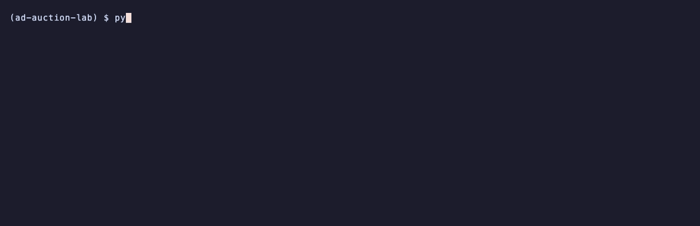
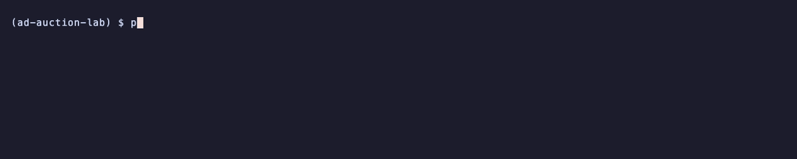
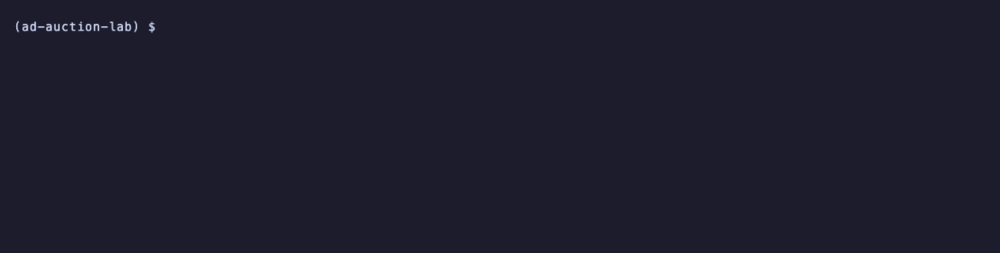
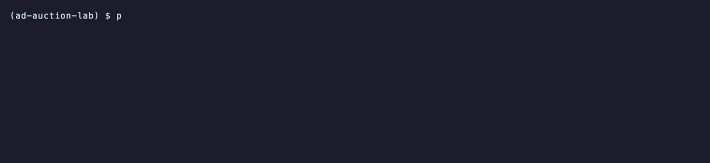

<h1 align="center">Ad Auction Lab</h1>

<p align="center">
  <em>A Python and Rust toolkit for the main parts of online advertising: click prediction, auctions, bidding, budget spending and testing new policies on old logs, each measured on public data.</em>
</p>

<p align="center">
  <a href="https://github.com/adeoluo/ad-auction-lab/actions/workflows/ci.yml"></a>
  <a href="https://github.com/adeoluo/ad-auction-lab/releases"></a>
  
  
  <a href="LICENSE"></a>
</p>

---

> **Evidence level: publicly benchmarked.** The results come from public data, Criteo ad click logs and the Open Bandit Dataset of fashion recommendation logs. The models and estimators are checked against reference libraries. No one else has reproduced them yet, and they have not been used in production.

## Highlights

Many online ads are sold in automated auctions, one auction for each time an ad is shown. This
project builds and tests the main parts of such a system: predicting clicks, running the auction,
choosing a bid and spending a budget evenly. It also estimates how a new policy would perform,
using logs collected under an older one.

- **The click model predicts clicks slightly better than the same model built with PyTorch.**
  Both models trained on 9.17 million rows of public Criteo click logs with the same features.
  The factorization machine (FM) has a test logloss of 0.4523, compared with 0.4532 for the
  version built with PyTorch (Meta's deep learning library). Logloss measures the error of
  predicted click probabilities, so lower is better.
- **The off-policy estimators give the same results as the reference library.** Off-policy
  evaluation (OPE) estimates how a new policy would perform from logs of an older one. On six
  Open Bandit Dataset settings, the largest difference from obp (Open Bandit Pipeline, the
  reference Python library for OPE) is 6.1e-18 (0.0000000000000000061). This is only
  floating-point rounding.
- **The auction tests agree with auction theory.** In the Vickrey-Clarke-Groves (VCG) auction, no
  tested bid change earned a bidder more than bidding its true value (0.0% of cases, where a case
  is one bidder in one auction), as theory predicts. A bid change paid off in up to 21.6% of
  cases in the generalized second price (GSP) auction, and in up to 59.2% in the first-price
  auction.
- **Bid shading and budget pacing come close to the best possible result.** Shaded first-price
  bids (bids set below the bidder's value) keep 99.8% to 100% of the surplus (value minus price)
  of an oracle that knows the test prices. For one advertiser, dual descent pacing (a rule that
  adjusts the bid after every auction) reaches 0.996 to 0.999 (99.6% to 99.9%) of the best result
  possible in hindsight. A PID controller (a standard feedback rule) reaches 0.32 to 0.98.
- **The Rust core gives identical results 58 to 162 times faster than the Python reference.**
  Training is 128 times faster for the FTRL-Proximal (follow-the-regularized-leader) click model
  and 96 times faster for the FM. The pacing simulator runs 58 to 162 times faster.

**Where it falls short:** the best published FM, from the BARS benchmark of click models, still
scores better. Its logloss is 0.4431 and its AUC (the chance that a click is ranked above a
non-click, higher is better) is 0.8086, compared with 0.4518 and 0.7991 here. It trained on four
times more data (36.7 million rows, compared with 9.17 million), and the gap has not been split
into a data part and a model part. No off-policy estimator is best in every setting. In one
setting (the men campaign, with the Thompson sampling policy estimated from the random log), every
estimator misses the true click rate by about 10%. The auctions and pacing are simulations built
from public price data, not live ad traffic.

## Key terms

Plain definitions of the terms used in this README.

| Term | Meaning |
|---|---|
| AUC | Area under the ROC curve: the chance that a random click scores higher than a random non-click. From 0 to 1, where 0.5 is guessing. Higher is better. |
| BARS | An open benchmark of click prediction models (Zhu et al. 2021). Its published Criteo results are quoted here for comparison, not rerun. |
| Bernoulli Thompson sampling (BTS) | A recommendation policy that picks each item with the chance that the item is the best one, judged from the clicks seen so far. |
| Bid shading | Bidding below one's value in a first-price auction to keep some profit. A lower bid pays less but wins less often. |
| Budget pacing | Lowering an advertiser's bids over time so that its budget lasts the whole period instead of running out early. |
| Click-through rate (CTR) | The share of ad views that get a click. A CTR model predicts this probability for each ad view. |
| Direct method (DM) | An off-policy estimator that uses a click model to predict the clicks the new policy would get. It is stable but wrong when the model is wrong. |
| Doubly robust (DR), SNDR, Switch-DR | DR adds to DM a weighted correction for the click model's errors. Self-normalized DR (SNDR) normalizes those weights. Switch-DR uses DM alone on rounds with very large weights. |
| Dual descent | A pacing rule that bids the value divided by (1 + mu). After each auction, it raises mu if that auction's spend exceeded the per-auction target, and lowers it otherwise. |
| Expected calibration error (ECE) | The average gap between predicted and actual click rates, over groups of rows with similar predictions. 0 is perfect. Lower is better. |
| Factorization machine (FM) | A click model that, besides one weight per feature, learns a short vector per feature so that it can score how pairs of features act together. |
| First-price auction | Each winner pays its own bid. Bidding one's true value then earns nothing, so bidders shade their bids. |
| FTRL-Proximal | Follow-the-regularized-leader, an online training method for logistic regression (a linear click model). Each feature gets its own learning rate, and a penalty sets many weights to zero. |
| Generalized second price (GSP) | Ads are ranked by bid weighted by quality score, and each winner pays the smallest bid that keeps its slot. With more than one slot it is not truthful. |
| Hash buckets | Feature hashing maps every raw feature value to one of a fixed number of slots, the buckets. More buckets mean fewer collisions but more memory. |
| Hindsight optimum | The most value a budget could buy if all prices were known in advance. Results are a ratio to it: 1 is the best possible. |
| Inverse propensity scoring (IPS), SNIPS | IPS reweights each logged click by how much more often the new policy would show that item. Self-normalized IPS (SNIPS) divides by the sum of weights, not the round count. |
| Logloss | The average penalty for predicted click probabilities, large when a confident prediction is wrong. 0 is perfect. Lower is better. |
| Normalized entropy | Logloss divided by the logloss of always predicting the training click rate. 1.0 means no better than that constant guess. Lower is better. |
| obp | Open Bandit Pipeline, the reference Python library for off-policy evaluation, released with the Open Bandit Dataset (Saito et al., 2021). Version 0.5.7 is used. |
| Off-policy evaluation (OPE) | Estimating how a new policy would perform from logs collected while a different policy was running. |
| Oracle surplus | The profit (value minus price) of the best bids fit on the test days themselves, which a real bidder cannot see. Results are a percentage of it. Higher is better. |
| PID controller | A feedback rule from control engineering. It sets the bid multiplier from the gap between planned and actual spend, the running sum of that gap and its change. |
| Profitable deviation | A bid other than the true value that earns a bidder more profit. In a truthful auction none exists, so 0% is the target. Lower is better. |
| VCG | Vickrey-Clarke-Groves auction: each winner pays the value its presence takes away from the other bidders. Theory says bidding one's true value is always best. |

## Motivation

An ad system makes three linked decisions for every impression (one showing of an ad). It
predicts how likely a click is. It decides who wins the auction and at what price. It also decides
how much each advertiser should bid, given a budget. Each decision is easy to get slightly wrong.
A miscalibrated click model, whose probabilities are too high or too low, sets the wrong price for
every slot. A pricing rule that is not truthful, so that a false bid can pay off, invites bid
manipulation. A pacing controller that overreacts can spend a daily budget by noon. Teams also
judge new policies offline, from logs collected by a different policy. So the estimate of a new
policy's value is itself a model, and it needs checking too.

This repository implements each part with the math written out in the docstrings (the
documentation inside the code). It measures each part on public data: 11.46 million Criteo click
rows, the full Open Bandit Dataset with 13.7 million logged rounds, and 16.5 million Criteo market
prices. It checks each part against reference libraries (obp, scikit-learn and PyTorch) and against
published numbers. scikit-learn is a standard Python machine learning library. The busiest loops
(FTRL, the factorization machine and the pacing simulator) run in a core written in Rust, a fast
compiled language. A Python reference version is kept so that parity tests can confirm that both
give the same results.

## Architecture

<p align="center">
  
</p>

<sub>Legend: amber marks entry points and external systems, indigo core logic, green data and state, blue validation and control, grey observability and outputs.</sub>

The command line interface (CLI) and the HTTP service check their inputs. They load data prepared
by `make data` as memory-mapped files, which are read from disk on demand: Criteo click rows, Open
Bandit logs and Criteo market prices. Two click-through rate (CTR) models run in Rust on hashed
features: FTRL logistic regression and a factorization machine. They produce the quality scores
that the auctions use to rank ads. The auctions are GSP, VCG and first price. They support reserve
prices (minimum prices) and a squashing exponent, which controls how much quality scores count in
the ranking. The bidding layer shades first-price bids and paces budgets against real market
prices. The off-policy estimators reuse the CTR models as reward models. Every result goes through
the same metrics (logloss, AUC, normalized entropy, calibration and bootstrap intervals) into JSON
files under `benchmarks/results/`. Bootstrap intervals are uncertainty ranges found by resampling
the data. The service counts requests at `/metrics`. Module details are in
[docs/ARCHITECTURE.md](docs/ARCHITECTURE.md). Key decisions are recorded in the [ADRs](docs/adr/)
(architecture decision records).

## Results

All numbers come from `make evaluation`, run on an Apple M1 laptop (8 cores, 8 GB of memory,
shared with other work). The raw JSON files are in [benchmarks/results/](benchmarks/results/), and
`make report` prints these tables. The full walkthrough, including threats to validity, is in
[docs/EVALUATION_REPORT.md](docs/EVALUATION_REPORT.md).

### Headline

Each row compares one part of this repository with a reference library, a published result or a
simpler method. Lower is better for logloss, estimator error and profitable deviations, and higher
is better for AUC, surplus, the pacing ratio and speedup.

| Component | Measured on | This repo | Compared with | Outcome |
|---|---|---:|---:|---|
| CTR, factorization machine | Criteo, 1.15M test rows, 3 splits | logloss 0.4518, AUC 0.7991 | PyTorch FM, same features (2^20): 0.4532 / 0.7975 | win (ours at 2^20: 0.4523 / 0.7985) |
| CTR, FTRL logistic regression | same, 1 pass | logloss 0.4602, AUC 0.7893 | scikit-learn SGD: 0.4675 / 0.7805 | win |
| CTR against published | Criteo | FM 0.4518 / 0.7991 on 9.17M rows | BARS FM 0.4431 / 0.8086 on 36.7M rows (quoted) | loss |
| Off-policy estimators | Open Bandit, 6 settings | max abs difference 6.1e-18 | obp 0.5.7 | tie (identical) |
| Off-policy accuracy | Open Bandit, 13.7M rounds | best estimator within 0.2% to 9.5% of on-policy truth | | no single best estimator |
| Auction incentives | 20,000 auctions x 24 configurations | VCG: 0.0% profitable deviations | GSP up to 21.6%, first price up to 59.2% | as theory predicts |
| Bid shading | Criteo prices, 10 later days | 99.8% to 100% of oracle surplus | log-normal landscape 97.9% to 99.6% | win |
| Budget pacing | 1M auctions, 5 seeds | dual descent 0.996 to 0.999 of hindsight optimum | PID 0.32 to 0.98 | win |
| Rust core | same inputs, identical outputs | FTRL 128x, FM 96x, pacing 58x to 162x | Python reference | win |

### CTR models on Criteo

The data is every 4th row of `train.txt` from the Criteo Display Advertising Challenge, a public
log of ad views and clicks. That is 11,460,155 of 45,840,617 rows, and 25.6% of them are clicks
(the base rate). The rows were split at random into 80% training, 10% validation and 10% test
rows (9,168,124 training, 1,146,015 validation and 1,146,016 test rows). Settings
(hyperparameters) were chosen on the validation rows
([ctr_sweep.json](benchmarks/results/ctr_sweep.json), [ctr_sweep_fm.json](benchmarks/results/ctr_sweep_fm.json)).
The test rows are used only in the results below. Results are the mean plus or minus the standard
deviation over 3 random splits. The models use 2^22 hash buckets (about 4.2 million). FTRL trains
for 2 passes over the data and the FM for 1 pass, because every FM overfits (starts to memorize
the training rows) on its second pass.

The table compares the two models on the test rows. Lower is better for logloss, normalized
entropy and ECE, higher is better for AUC, and a calibration ratio (mean prediction divided by
actual click rate) of 1.0 is ideal.

| Model | Test logloss | Test AUC | Normalized entropy | Calibration (pred / actual) | ECE |
|---|---:|---:|---:|---:|---:|
| LR, FTRL-Proximal (alpha 0.05, L1 1) | 0.4586 ± 0.0003 | 0.7911 ± 0.0001 | 0.8059 ± 0.0005 | 1.004 ± 0.002 | 0.0028 ± 0.0003 |
| Factorization machine (k 32, AdaGrad 0.01) | 0.4518 ± 0.0002 | **0.7991 ± 0.0001** | 0.7939 ± 0.0004 | 0.998 ± 0.002 | 0.0062 ± 0.0002 |
| FM + isotonic calibration (fit on validation) | **0.4516 ± 0.0002** | **0.7991 ± 0.0001** | **0.7935 ± 0.0004** | 1.001 ± 0.000 | **0.0012 ± 0.0002** |

In the model names, k is the length of each FM feature vector, and alpha and L1 are FTRL settings.
AdaGrad (a method that adapts each feature's learning rate) trains the FM. On the test split of
seed 0 (the first random split), the FM beats FTRL by +0.0083 AUC. The DeLong test, a standard test
for comparing two AUCs on the same rows, gives a 95% confidence interval of +0.0080 to +0.0085. The
FM's logloss is also lower, by 0.0070 (difference -0.0070, paired 95% interval -0.0073 to -0.0068).
Isotonic calibration remaps predicted probabilities with a non-decreasing step function fit on the
validation rows. It cuts the FM's expected calibration error by 5 times. Platt scaling, a remapping
with a logistic curve, leaves it unchanged (0.0061).

The next table compares this repository's models with reference libraries on the same hashed
features and the same seed 0 splits. Each library was tuned on the validation rows with its own
small grid of settings
([ctr_reference_sklearn.json](benchmarks/results/ctr_reference_sklearn.json),
[ctr_reference_torch.json](benchmarks/results/ctr_reference_torch.json)). Each row is one model:
lower test logloss, higher test AUC and fewer training seconds ("Train s") are better.

| Model | Buckets | Passes | Test logloss | Test AUC | Train s | Result |
|---|---:|---:|---:|---:|---:|---|
| This repo: FTRL-Proximal | 2^22 | 1 | **0.46016** | **0.78926** | **11.5** | win |
| scikit-learn `SGDClassifier` (log loss, best of 7 step sizes) | 2^22 | 1 | 0.46753 | 0.78053 | 53 | loss |
| This repo: factorization machine (k 32) | 2^20 | 1 | **0.45226** | **0.79853** | **81** | win |
| PyTorch FM (k 32, sparse Adagrad, batch 1024, best of 3 rates x 2 passes) | 2^20 | 1 | 0.45324 | 0.79748 | 275 | loss |
| Constant base rate | | | 0.56904 | 0.50000 | | |

scikit-learn's `SGDClassifier` trains logistic regression by stochastic gradient descent. The
PyTorch FM runs at 2^20 buckets (about 1 million). At 2^22, its factors and Adagrad state (the
learned vectors and the optimizer's running statistics, 1 GB) made the shared 8 GB machine swap
memory to disk. So it is compared with this repository's FM at the same size. Its best learning
rate was the smallest in its grid (0.02), so a smaller rate might narrow the 0.001 gap.
scikit-learn's time includes building sparse matrices (tables that store only nonzero values)
from the hashed rows.

The next table quotes published numbers from the [BARS benchmark](https://openbenchmark.github.io/BARS/CTR/leaderboard/criteo_x4.html)
(Zhu et al. 2021), which were not rerun here. Each row is one model and its training set size,
where lower test logloss and higher test AUC are better.

| Model | Train rows | Test logloss | Test AUC |
|---|---:|---:|---:|
| This repo: LR, FTRL-Proximal | 9.17M | 0.4586 | 0.7911 |
| This repo: factorization machine | 9.17M | 0.4518 | 0.7991 |
| BARS: LR | 36.7M | 0.4568 | 0.7934 |
| BARS: FM | 36.7M | 0.4431 | 0.8086 |
| BARS: FFM | 36.7M | 0.4407 | 0.8113 |
| BARS: DeepFM | 36.7M | 0.4376 | 0.8143 |

LR is logistic regression. FFM (field-aware factorization machine) and DeepFM (an FM combined with
a neural network) are larger models not built here. BARS trains on the full 36.7-million-row
split. Its vocabulary keeps features seen at least 10 times (minimum count 10), and its embedding
size (the length of the learned vector for each feature) is 16. So the gap mixes two effects: the
4 times smaller training set here, and the model difference.

An ablation changes one part of the setup to see how much it matters, and each row below changes
one setting of the full model. The columns give test logloss (lower is better) and AUC (higher is
better) for FTRL and the FM on the seed 0 test split
([ctr_ablation.json](benchmarks/results/ctr_ablation.json)).

| Ablation | FTRL logloss | FTRL AUC | FM logloss | FM AUC |
|---|---:|---:|---:|---:|
| Full model (2^22 buckets, 39 fields, 9.17M rows) | 0.45869 | 0.79097 | 0.45165 | 0.79922 |
| 2^16 buckets | 0.46441 | 0.78389 | 0.45521 | 0.79491 |
| 2^20 buckets | 0.45917 | 0.79036 | 0.45226 | 0.79853 |
| 2^24 buckets | 0.45855 | 0.79113 | not run | not run |
| 13 integer fields only | 0.51190 | 0.71463 | 0.50809 | 0.72001 |
| 26 categorical fields only | 0.48077 | 0.76229 | 0.47561 | 0.76978 |
| 100k training rows | 0.48622 | 0.75509 | 0.48838 | 0.75350 |
| 1M training rows | 0.46951 | 0.77767 | 0.46814 | 0.77971 |
| 3M training rows | 0.46330 | 0.78545 | 0.45911 | 0.79065 |

The FM at 2^24 buckets (about 16.8 million) needs 4 GB of factors and AdaGrad state at k = 32,
so it was not run. FM rank k = 1, 4, 16 and 32 gives test logloss 0.46003, 0.45735, 0.45315 and
0.45165. The L1 penalty pushes small FTRL weights to exactly zero. At L1 = 1 it halves the
number of nonzero weights (3,722,562 to 1,775,280) for +0.00014 logloss. At L1 = 16 it keeps
48,888 weights, with logloss 0.46114. FTRL beats the FM at 100,000 training rows, and also on
logloss at 300,000. The FM still gains about 0.005 AUC per doubling of the training set between
3 million and 9.17 million rows. This suggests, without a direct test, that most of the 0.0095
AUC gap to the BARS FM comes from the 4 times smaller sample.

The next table compares the speed of the Rust core and the Python reference, in rows per second
(higher is better). Both ran back to back in one process on the same 200,000 training rows and
20,000 prediction rows at 2^20 buckets, and their predictions are identical
([ctr_speed.json](benchmarks/results/ctr_speed.json)).

| Model | Rust train rows/s | Python train rows/s | Speedup | Rust predict rows/s | Python predict rows/s |
|---|---:|---:|---:|---:|---:|
| FTRL-Proximal | 794,078 | 6,227 | 128x | 1,003,632 | 29,667 |
| Factorization machine (k 32) | 57,810 | 604 | 96x | 633,231 | 1,798 |

On the full 9.17-million-row training split, FTRL trained 0.7 million to 2.9 million rows per
second and the FM 37,000 to 290,000, depending on machine load.

### Off-policy evaluation on the Open Bandit Dataset

The Open Bandit Dataset holds recommendation logs from ZOZOTOWN, a fashion shopping site. Its "all"
campaign has 13.73 million rounds, and the "men" and "women" campaigns are subsets of it. A round
is one recommendation shown and whether it was clicked. The data was logged twice: once by a
uniform random policy (every item equally likely) and once by Bernoulli Thompson sampling (BTS).
Each setting estimates one policy's click rate from the other policy's log. It then compares the
estimate with the click rate that policy actually achieved, the on-policy truth (as in Saito et al.
2021). Relative error is the absolute gap between estimate and truth, divided by the truth. DM and
the DR family use the smoothed item-position click model: a click rate per item and position,
pulled toward the position's average when data is scarce. The 95% intervals come from 200 Poisson
bootstrap replicates, which reweight the rounds with random counts
([ope_obd.json](benchmarks/results/ope_obd.json)).

Each row is one setting, such as "BTS from random" (BTS estimated from the random log), with the
log size in rounds. "Truth" is the achieved click rate, and the other columns give each
estimator's relative error (lower is better, bold is best).

| Setting (log rounds) | Truth | IPS | SNIPS | DM | DR | SNDR | Switch-DR |
|---|---:|---:|---:|---:|---:|---:|---:|
| all: BTS from random (1.37M) | 0.00495 | **0.003** | 0.005 | 0.006 | 0.006 | 0.006 | 0.006 |
| all: random from BTS (12.36M) | 0.00347 | 0.010 | 0.050 | **0.002** | 0.039 | 0.037 | 0.012 |
| men: BTS from random (0.45M) | 0.00674 | 0.109 | 0.099 | 0.096 | **0.095** | **0.095** | **0.095** |
| men: random from BTS (4.08M) | 0.00512 | 0.025 | 0.070 | **0.020** | 0.041 | 0.036 | 0.047 |
| women: BTS from random (0.86M) | 0.00638 | 0.032 | 0.031 | 0.030 | **0.029** | **0.029** | **0.029** |
| women: random from BTS (7.77M) | 0.00482 | 0.044 | 0.080 | 0.005 | 0.064 | 0.061 | **0.004** |

No estimator wins everywhere. Evaluating the uniform policy from the BTS log is the hard direction.
There, importance weights (how much more often the new policy picks a logged item than the old
policy did) reach 29,412 on the men campaign. The effective sample size, the number of equally
weighted rounds that would give the same precision, is 1,513 of 4.08 million rounds there. In this
direction, DM and Switch-DR avoid the largest weights. DM is best or second best in all three
campaigns, and Switch-DR is best on the women campaign. SNIPS is worst in all three campaigns. In the easy direction (weights at most 10), every estimator is within 0.7% on the
all campaign. In the same direction on the men campaign, every estimator misses by about 10%, and
no interval covers the truth. IPS, which uses no model, shares this error. So the error comes from
the evaluation setup rather than from an estimator. The target policy is represented by BTS's
average item distribution, but BTS changed over the week.

On the random logs, which include user context, cross-fitted contextual reward models were also
tried. These are hashed FTRL and FM models with user, item and user-by-item features, each scored
only on rounds it did not train on. They made DM worse than the item-position model (relative error
0.094 and 0.064, compared with 0.006 on all) and left DR unchanged, because the click signal is
weak (0.35% CTR). Switch-DR's threshold matters only in the hard direction. On all, switching to
the model above the 99th percentile of the weights gives 0.012, above the 90th percentile under
0.001, and no switching (plain DR) 0.039
([ope_ablation.json](benchmarks/results/ope_ablation.json)). The default (99th percentile) was
fixed before these runs. The error for BTS from random was also measured on 30 random subsamples
per size. For every estimator, it falls from 0.18 to 0.20 at 10,000 rounds to 0.047 to 0.048 at
300,000 rounds. In the hard direction at 10,000 rounds, DR is off by 0.53 on average, and DM and
Switch-DR by 0.20 and 0.19 ([ope_curve.json](benchmarks/results/ope_curve.json)).

The next table checks agreement with [obp](https://github.com/st-tech/zr-obp) 0.5.7 on
200,000-round samples of all six settings ([ope_obp.json](benchmarks/results/ope_obp.json)). Each
row is one estimator: its largest absolute difference from obp (lower is better), its point
estimate speedup, and its bootstrap speed relative to obp (below 1 means slower).

| Estimator | Max abs difference from obp | Point estimate speedup | Bootstrap time vs obp |
|---|---:|---:|---:|
| IPS | 0.0e+00 | 89x | 0.6x (slower) |
| SNIPS | 1.7e-18 | 63x | 0.5x (slower) |
| DM | 5.2e-18 | 56x | 0.9x (slower) |
| DR | 5.2e-18 | 97x | 1.3x |
| SNDR | 5.2e-18 | 90x | 0.6x (slower) |
| Switch-DR | 6.1e-18 | 69x | 0.9x (slower) |

Point estimates agree up to floating-point rounding. For intervals, obp resamples row indices,
while this implementation draws Poisson weights. Timed per estimator (100 replicates, 200,000
rounds), this implementation is slower in 5 of 6 cases. In the benchmark it draws the weights once
for all estimators of a log (`bootstrap_many`), and this per-estimator timing does not credit that
saving.

### Auctions, reserves and incentives

Values and quality scores come from real data. A bidder's value per click is a resampled Criteo
Attribution market price divided by a resampled FM-predicted CTR from the Criteo test split. A
market price is the price Criteo paid for an ad view it won. Quality scores are resampled FM CTRs.
Each configuration runs 20,000 auctions. Every bidder in turn tries 13 other bids, from 0 to 4
times its true value, while the others bid their true values
([auction_incentives.json](benchmarks/results/auction_incentives.json)).

Each row is one auction type, and each column gives the share of bidder-auctions where some
tested bid change beat bidding the true value. Lower is better, and a truthful auction should show
0%.

| Mechanism | Bidder-auctions with a profitable deviation (no reserve) | With the empirical reserve |
|---|---:|---:|
| VCG (affine maximizer) | **0.0%** in all 12 configurations | **0.0%** |
| GSP | 0.0% with 1 slot, 7.0% to 21.6% with 3 to 5 slots | 0.0% to 0.6% |
| First price | 9.6% to 59.2% | 4.9% to 7.2% |

The lowest envy-free equilibrium of Edelman, Ostrovsky and Schwarz is a stable set of GSP bids in
which no advertiser would rather have another's slot at that slot's price. At this equilibrium,
GSP gives the same allocation as VCG in 100% of 4,000 auctions, and VCG's revenue to a relative
difference of 4.3e-16. Truthful GSP bidding would instead collect 1.8 times (5 bidders, 3 slots)
and 2.0 times (10 bidders, 5 slots) the VCG revenue. The closed-form VCG prices are computed
directly from a formula. They match an exhaustive search with Clarke payments (the textbook VCG
payment rule) on 1,800 auctions, with a largest difference of 4.7e-13.

A reserve price is the lowest price the seller accepts. The Myerson reserve is the textbook
revenue-maximizing reserve for a known value distribution, here a log-normal fit. The empirical
reserve is the reserve that earned the most on the training values. The reserves below are used
in second-price auctions, fit on 200,000 values and tested on 1,000,000 auctions
([auction_reserves.json](benchmarks/results/auction_reserves.json)).

In the table, each row is a market size, and the revenue columns give mean revenue per auction
with a 95% interval (higher is better). The last column gives the share of welfare, the total
value to the winners, kept with the empirical reserve.

| Bidders | No reserve: revenue | Myerson reserve (log-normal fit) | Empirical reserve | Welfare kept (empirical) |
|---:|---:|---:|---:|---:|
| 1 | 0.000 | 1.215 ± 0.007 | **1.244 ± 0.009** | 67% |
| 2 | 1.135 ± 0.006 | 2.417 ± 0.010 | **2.471 ± 0.013** | 70% |
| 5 | 4.848 ± 0.016 | 5.929 ± 0.018 | **6.012 ± 0.022** | 79% |
| 10 | 10.795 ± 0.027 | 11.435 ± 0.028 | **11.526 ± 0.030** | 91% |

The empirical reserve beats the Myerson reserve of a log-normal fit at every market size. The
reason is that the real value distribution is heavier tailed than log-normal: very high values are
more common than a log-normal fit predicts. The revenue gain from any reserve shrinks from 2.2
times with 2 bidders to 7% with 10 bidders, and the welfare cost also falls.

### First-price bid shading

In a first-price auction the best bid is below the value. It depends on the bid landscape, the
estimated chance of winning at each bid. Here the landscape is fit on the first 21 days of the
Criteo Attribution prices (11,405,791 impressions) and scored on the last 10 days (5,062,236). The
shaded bids are compared with an oracle that is fit on the test days themselves
([bid_shading.json](benchmarks/results/bid_shading.json)).

Each row is a bidder's value as a multiple of the median market price. The columns give surplus
(value minus price, over the auctions won) as a percentage of the oracle's. They cover truthful
bids, a log-normal landscape and the exact empirical landscape. Higher is better.

| Value / median price | Truthful bid: surplus | Log-normal landscape | Empirical landscape (exact, convex hull) |
|---:|---:|---:|---:|
| 0.5 | 0% of oracle | 97.9% | **99.8%** |
| 1 | 0% | 98.3% | **100.0%** |
| 2 | 0% | 99.2% | **100.0%** |
| 5 | 0% | 99.6% | **100.0%** |
| 20 | 0% | 99.6% | **100.0%** |

Bidding the true value in a first-price auction wins most often and earns nothing. The empirical
landscape keeps 99.8% to 100% of the oracle's surplus a week and a half later. A second test uses
the 20 largest campaigns, with the value set to 2 times the campaign median. There, a campaign's
own landscape keeps 0.997 plus or minus 0.003 of the oracle surplus (mean and standard deviation
over campaigns). The pooled landscape of all campaigns keeps 0.980 plus or minus 0.018 (worst
0.945). Shading 1 million values against the 11.4 million training prices takes 1.3 seconds after
a 3.9-second fit.

### Budget pacing

Advertisers bid in repeated second-price auctions against an external market. The market is a
continuous, time-ordered window of the Criteo Attribution prices, so daily patterns stay. Each
auction's CTRs are drawn from the FM's test predictions. Each budget is a share of what that
advertiser would spend without pacing. The runs use 1,000,000 auctions, with the mean plus or
minus the standard deviation over 5 random seeds ([pacing.json](benchmarks/results/pacing.json)).

Each row is a market size and budget share, and the PID and dual descent columns give value won
as a multiple of no pacing (higher is better). The last column gives the point in the period, from
0 to 1, when budgets ran out under no pacing, PID and dual descent.

| Advertisers | Budget | Value won vs no pacing: PID | Dual descent | Budget exhausted at (none / PID / dual) |
|---:|---:|---:|---:|---:|
| 5 | 10% | 3.22 ± 0.14 | **5.23 ± 0.15** | 0.10 / 0.94 / 1.00 |
| 10 | 10% | 3.40 ± 0.16 | **5.49 ± 0.16** | 0.10 / 0.94 / 1.00 |
| 20 | 10% | 3.53 ± 0.08 | **5.67 ± 0.13** | 0.10 / 0.94 / 1.00 |
| 10 | 30% | 2.33 ± 0.04 | **2.55 ± 0.04** | 0.30 / 0.95 / 1.00 |
| 10 | 60% | 1.48 ± 0.01 | **1.51 ± 0.01** | 0.60 / 0.98 / 1.00 |

A single advertiser is also compared with the fractional knapsack optimum in hindsight. This is
the best use of the budget if all prices were known in advance and part of an auction could be
bought. Dual descent reaches 0.996 to 0.999 of this optimum at budgets from 5% to 60%. PID reaches 0.32 to
0.98, and no pacing 0.18 to 0.71. With these gains (tuning constants), PID reacts too slowly at
small budgets. The Rust simulator runs 2.9 million to 122 million auctions per second, 58 to 162
times the speed of the Python reference, with identical results
([pacing_speed.json](benchmarks/results/pacing_speed.json)).

## Quickstart

The commands use make (a build tool) and uv (a Python package manager). Setup compiles the Rust
core, so it needs a Rust toolchain.

```bash
git clone https://github.com/adeoluo/ad-auction-lab.git && cd ad-auction-lab
make setup           # uv sync (compiles the Rust core; needs a Rust toolchain) + pre-commit
make all             # lint, type check, tests

python -m ad_auction_lab auction --bids 4,2,1 --quality 0.05,0.08,0.06 --slots 0.3,0.2 --reserve 0.5
python -m ad_auction_lab incentives --auctions 5000 --bidders 5
```

The data commands need the prepared datasets (about 2.1 GB). The downloads are streamed, so the
compressed archives are never stored:

```bash
make data            # Criteo 1 in 4, Open Bandit Dataset, Criteo Attribution into ../.bench-data/ad-auction-lab
make validation      # scikit-learn, PyTorch and obp for the reference comparisons
make evaluation      # every benchmark (several hours on an M1); make report prints the tables
```

## Usage

### Command line

| Command | What it does |
|---|---|
| `auction` | one position auction under GSP, VCG and first price, with reserve and quality squashing |
| `incentives` | share of bidders with a profitable deviation from truthful bidding, per mechanism |
| `shade` | first-price bid shading against the empirical landscape of Criteo market prices |
| `pace` | budget pacing (none, PID, dual descent) in a multi-advertiser market built from real data |
| `train-ctr` | train FTRL or the factorization machine on Criteo, report test metrics, save the model |
| `ope` | IPS, SNIPS, DM, DR, SNDR and Switch-DR on an Open Bandit campaign, with bootstrap intervals |
| `serve` | the HTTP service |

```bash
D=../.bench-data/ad-auction-lab
python -m ad_auction_lab train-ctr --data $D --model fm --k 32 --lr 0.01 --out fm.npz
python -m ad_auction_lab ope --data $D --campaign all --target bts --boot 200
python -m ad_auction_lab pace --data $D --horizon 2000000 --advertisers 10 --budget-share 0.3
```

### Library

```python
import numpy as np

from ad_auction_lab.auctions import run_auctions
from ad_auction_lab.ctr import FactorizationMachine
from ad_auction_lab.data import split_rows, synthetic_clicks
from ad_auction_lab.metrics import summary
from ad_auction_lab.ope import BanditLog, estimate, uniform_action_dist

# Three GSP auctions at once: bids and quality scores are (T, n), slot CTRs are (K,).
r = run_auctions(
    [[4, 2, 1], [1, 3, 2], [2, 2, 5]],
    [[0.05, 0.08, 0.06]] * 3,
    [0.3, 0.2],
    mechanism="gsp",
    reserve=0.5,
)
print(r.winner, r.price, r.revenue())

# A hashed factorization machine on synthetic clicks in the Criteo layout.
t = synthetic_clicks(200_000, seed=0)
train, valid, test = split_rows(len(t), seed=0)
fm = FactorizationMachine(k=8, lr=0.02, bits=18)
fm.fit(t, train, epochs=3, valid_rows=valid, patience=1)
print(summary(t.labels[test], fm.predict_proba(t, test), float(t.labels[train].mean())))

# IPS and SNIPS value of the uniform policy from a log of 3 actions in 1 position.
rng = np.random.default_rng(0)
a = rng.integers(0, 3, 10_000)
log = BanditLog.from_arrays(
    (rng.random(10_000) < 0.1 * (a + 1)).astype(float),
    a,
    np.full(10_000, 1 / 3),
    np.zeros(10_000, int),
    3,
    1,
)
print(estimate("ips", log, uniform_action_dist(3, 1)))
```

### HTTP service

A threaded service built only on the Python standard library, with request validation and size
limits:

```bash
python -m ad_auction_lab serve --port 8000 --model fm.npz

curl localhost:8000/health
curl -s -X POST localhost:8000/auction \
  -d '{"bids": [4, 2, 1], "quality": [0.05, 0.08, 0.06], "slot_ctr": [0.3, 0.2], "mechanism": "vcg", "reserve": 0.5}'
curl localhost:8000/metrics
```

`POST /shade` returns shaded first-price bids for given values, against a sample of market prices.
`POST /predict` scores hashed feature rows with the loaded CTR model. `POST /ope` runs the
estimators on a posted log. `GET /ready` reports whether the service is ready. `GET /metrics`
shows request, error and latency counters for each route, in the Prometheus text format (a common
monitoring format).

### Demos

Recorded from real runs with [vhs](https://github.com/charmbracelet/vhs), a tool that records terminal sessions. Each tape (vhs script) is in `docs/demo/`.

One auction under the three auction types, then the incentive check: only VCG leaves no bidder a
profitable deviation.

<p align="center">
  
</p>

The factorization machine trained on 1 million Criteo rows, with test logloss, AUC, normalized
entropy and calibration.

<p align="center">
  
</p>

Off-policy estimates of the BTS policy from the 1.37-million-round uniform random log, compared
with the click rate the policy achieved in its own 12.36 million rounds.

<p align="center">
  
</p>

Ten advertisers pacing their budgets over 2 million auctions priced by the Criteo market data.

<p align="center">
  
</p>

## Design decisions

- **Hashed CTR models in a Rust core.** Online learning updates the model one row at a time.
  The numpy library (Python's array library) cannot vectorize this loop, that is, run it as one
  array operation. The Rust FTRL and FM train 128 and 96 times faster than the Python reference
  and give identical predictions. ([ADR-0002](docs/adr/0002-hashed-ctr-models-in-a-rust-core.md))
- **FTRL-Proximal and an AdaGrad factorization machine, trained in log order.** Production CTR
  systems use a learning rate per feature and L1 sparsity (many weights set to exactly zero).
  Training in time order matches how those systems see data. ([ADR-0003](docs/adr/0003-ftrl-proximal-and-adagrad-fm-in-log-order.md))
- **Off-policy estimators as per-round terms.** Every estimator reduces to a mean of per-round
  terms plus a ratio of sums. This gives one bootstrap method for all of them, and agreement with
  obp up to floating-point rounding. ([ADR-0004](docs/adr/0004-ope-as-round-terms-matching-obp.md))
- **Closed-form position auctions with numeric incentive checks.** VCG with quality weights and
  reserves is an affine maximizer: it picks the allocation with the highest weighted value, which
  keeps truthful bidding optimal. It is checked against brute-force search. Truthfulness is tested
  by searching bid changes on values built from real data. ([ADR-0005](docs/adr/0005-vcg-as-an-affine-maximizer-with-numeric-incentive-checks.md))
- **Pacing on real prices and CTRs.** The external market comes from Criteo's paid prices and the
  CTRs from the trained FM. So the controllers face real heavy tails (rare, very high prices) and
  drift (changes over time). ([ADR-0006](docs/adr/0006-pacing-simulator-on-real-prices-and-ctrs.md))
- **Datasets within a disk budget.** Criteo is streamed and kept at 1 row in 4, in time order.
  Nothing is stored compressed. ([ADR-0007](docs/adr/0007-datasets-within-the-disk-budget.md))

## Testing

The checks use ruff (a Python code checker), mypy (a type checker), pytest (the test runner) and
cargo (Rust's build tool).

```bash
make lint        # ruff format --check and ruff check
make type        # mypy src (strict)
make coverage    # pytest with an 80% gate (192 tests, 98% branch coverage locally)
make rust-check  # cargo fmt, clippy and the Rust unit tests
make parity      # Rust core against the numpy reference, extension required
make validation  # against obp 0.5.7 and scikit-learn
```

- `test_auctions.py`: textbook GSP and VCG examples, quality scores, squashing, reserves and
  ties. The VCG closed form is checked against exhaustive search with Clarke payments. On random
  auctions generated by hypothesis (a library that generates random test inputs), no tested bid
  change helps a VCG bidder. On 500 seeded random auctions, GSP and first price are shown not to
  be truthful. GSP at the envy-free equilibrium matches VCG revenue. With two bidders whose values
  are uniform from 0 to 1, the Myerson reserve gives the known revenue of five twelfths. Empirical
  reserves are checked too.
- `test_bidding.py`, `test_pacing.py`: shading against brute force on the landscape, the
  symmetric first-price equilibrium, log-normal landscape fits, budgets never exceeded, dual
  descent approaching the hindsight optimum, and the hindsight bound against greedy subsets.
  `test_pacing.py` also checks the Rust pacing simulator against the Python reference.
- `test_ctr.py`, `test_hashing.py`, `test_metrics.py`, `test_data.py`: FTRL and FM learning, L1
  sparsity, early stopping (ending training when validation results stop improving), and save and
  load, with a loader that refuses to run code. Also hashing stability, AUC against brute force
  with ties, DeLong variance against the bootstrap, Platt and isotonic calibration, Criteo parsing
  and integer binning (grouping integer values into ranges).
- `test_ope.py`, `test_obd.py`: hand-computed estimates, recovery of a known policy value, DR
  unbiased with a wrong model, bootstrap intervals against the analytic standard error, and
  cross-fitted reward models that never score a round they trained on.
- `test_rust_parity.py`: the Rust FTRL and FM against the numpy reference.
- `test_cli.py`, `test_service.py`: every command and route, malformed and oversized requests,
  metrics counters, and a real network socket round trip.
- `test_validation.py` (runs only when requested): every estimator against obp 0.5.7, on
  synthetic logs and an Open Bandit sample. Also the metrics, isotonic calibration and logistic
  regression against scikit-learn.

Continuous integration (CI, the automatic checks in `.github/workflows/ci.yml`) runs the format
check, lint (style and error checks), type check and tests on Python 3.12, 3.13, 3.14 and 3.15.
The tests have a coverage gate: they fail if they cover less than 80% of the code's lines and
branches. CI also runs the Rust checks with the parity tests, the reference-library tests, and a
package build and a Docker image build (a container image of the service). CodeQL (GitHub's code
security scanner) runs on main and weekly.

## Responsible AI

- **Model card:** [docs/MODEL_CARD.md](docs/MODEL_CARD.md)
- **Data card:** [docs/DATA_CARD.md](docs/DATA_CARD.md)
- **Threat model:** [docs/THREAT_MODEL.md](docs/THREAT_MODEL.md)

The models predict clicks on anonymized public logs. Nothing here targets real users or spends
money. Off-policy estimates are reported with intervals and with their error against the
on-policy truth, so a confident but wrong estimate is visible.

## Limitations

- Criteo is used at 1 row in 4 (9.17 million training rows) to fit the disk and memory budget. So
  the CTR numbers are not directly comparable with published results on the full
  36.7-million-row split. The gap to the BARS FM (0.0095 AUC) has not been split into a data part
  and a model part.
- The FM at 2^24 buckets, FFM and deep CTR models were not run, because of the memory limit of an
  8 GB machine.
- The OPE target policies are context free: they ignore user features. The BTS policy is
  represented by its average item distribution over the week. This is why every estimator misses
  by about 10% on the men campaign when BTS is estimated from the random log.
- The auction values are built from market prices and predicted CTRs, not from real advertiser
  values. The incentive check searches a grid of 13 bid factors while the others bid truthfully.
  It finds profitable deviations, but it cannot prove that there are none.
- Market prices are Criteo's prices for impressions it won. They are censored (only won
  impressions are seen) and rescaled, so shading and pacing results are relative, not in
  currency.
- Timings were taken on a shared machine whose load varied during the runs. The load average (the
  number of processes running or waiting for the processor) reached 108 during the final CTR
  runs. The tables comparing Rust with Python run both sides back to back to keep the comparison
  fair. Still, absolute FM training speed varied from 37,000 to 290,000 rows per second between
  runs.
- Installing from source compiles the Rust core and needs a Rust toolchain. `backend="python"`
  selects the slower reference implementations.

## Roadmap

- [ ] Field-aware factorization machines and a small DeepFM, to study the gap to the published numbers.
- [ ] Contextual target policies, which use user features, on the Open Bandit Dataset (the BTS log has no user context).
- [ ] Bid landscapes that depend on context, and pacing with a return-on-investment (ROI) constraint.
- [ ] Multi-threaded FTRL training in the Rust core, with Hogwild (lock-free parallel updates).

## License

Released under the [MIT License](LICENSE).
