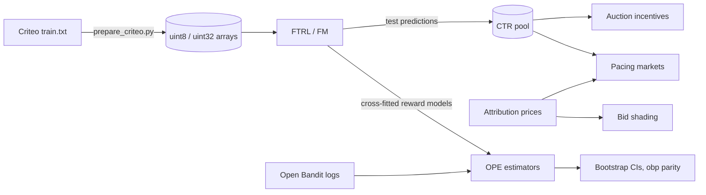

# Architecture - Ad Auction Lab

The README diagram shows the four layers. This page lists what each module does and how data
moves between them.

## Modules

| Layer | Module | Responsibility |
|---|---|---|
| Interfaces | `cli.py` | `python -m ad_auction_lab` commands: `auction`, `incentives`, `shade`, `pace`, `train-ctr`, `ope`, `serve` |
| Interfaces | `service.py` | Standard-library threaded HTTP service: `/health`, `/ready`, `/metrics` (Prometheus text), `/auction`, `/shade`, `/predict`, `/ope`; request validation and size limits |
| Data | `data.py` | `Table` (uint8 small block, uint32 wide block, labels), Criteo parsing and integer binning, memory-mapped loader, seeded splits, synthetic data for tests |
| Data | `obd.py` | Open Bandit Dataset loader, contextual reward features, cross-fitted reward models |
| Core | `hashing.py`, `rust/src/hashing.rs` | SplitMix64 feature hashing shared by Python and Rust |
| Core | `ctr.py`, `rust/src/ftrl.rs`, `rust/src/fm.rs` | FTRL-Proximal logistic regression and the AdaGrad factorization machine; training loop, early stopping, save and load |
| Core | `ctr_reference.py` | Per-row Python references of both learners for parity tests |
| Core | `auctions.py` | Vectorized GSP, VCG (affine maximizer) and first-price position auctions with reserves and squashing; VCG brute force; GSP envy-free equilibrium; deviation gains; Myerson and empirical reserves |
| Core | `bidding.py` | First-price bid shading on empirical (exact, convex hull) and log-normal landscapes; equilibrium bids for validation |
| Core | `pacing.py`, `rust/src/pacing.rs` | Multi-advertiser pacing simulator (none, PID, dual descent), Python reference, hindsight LP optimum, markets built from real prices and CTRs |
| Core | `ope.py` | IPS, SNIPS, DM, DR, SNDR, Switch-DR as per-round terms; Poisson bootstrap; policy summaries; item-position reward model |
| Evaluation | `metrics.py` | Log loss, AUC (midranks), normalized entropy, reliability table and ECE, DeLong and paired log-loss tests |
| Evaluation | `calibration.py` | Platt scaling (Newton) and isotonic regression (pool adjacent violators) |
| Backend | `backend.py` | Loads the compiled extension and resolves `backend="auto" / "rust" / "python"` |

## Data flow

1. `scripts/download_data.sh` streams the three public datasets into compact arrays.
2. The CTR models train on Criteo; their test predictions become the quality scores and CTRs of
   the auction and pacing benchmarks, so the market simulations use realistic CTR distributions.
3. The off-policy estimators read Open Bandit logs; the hashed CTR learners double as contextual
   reward models through `cross_fit_model_terms`.
4. Every benchmark writes JSON with the machine description to `benchmarks/results/`;
   `benchmarks/report.py` prints the README tables from those files.
